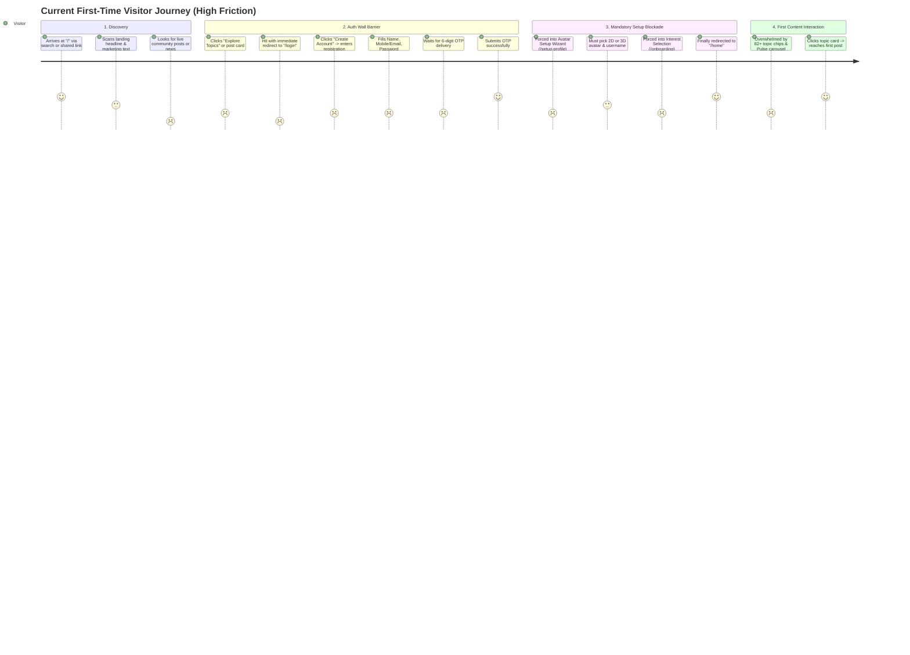
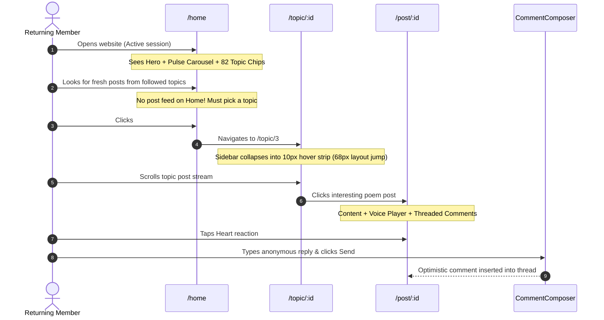
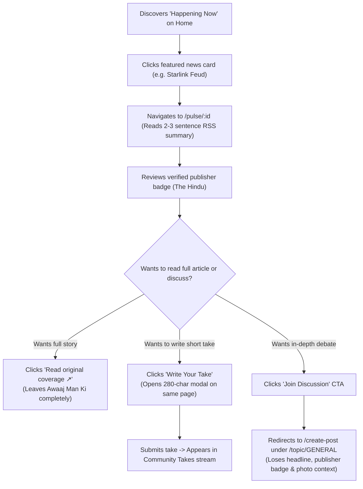
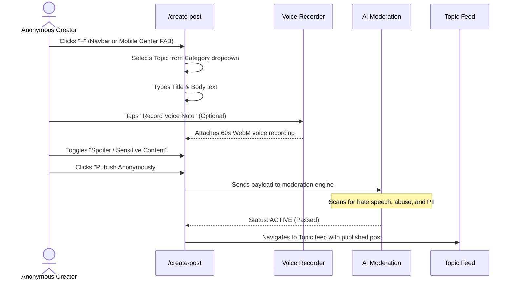
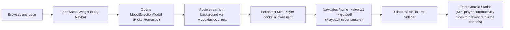
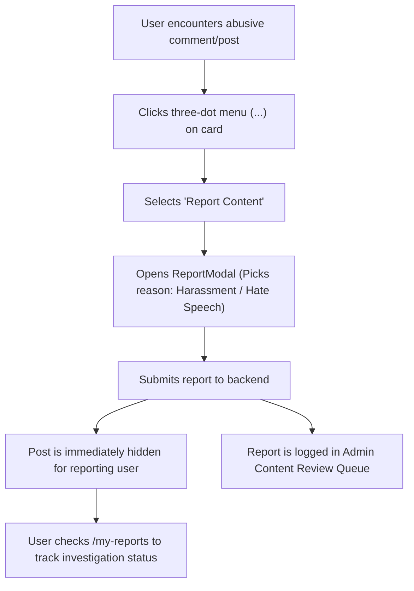

# Awaaj Man Ki — Current User Flow Map
## Document: CURRENT_USER_FLOW_MAP.md

**Role:** Principal UX Architect & Product Design Director  
**Purpose:** Map the exact step-by-step user journeys on the current platform, comparing designed flows against user realities, friction barriers, and dead ends.

---

### Journey A: First-Time Visitor Experience

#### Analytical Breakdown:
- **Entry Point:** Direct URL (`/`), search engine, or shared social link.
- **The Core Friction Point:** The landing page displays zero live content. When a visitor attempts to see what real people are saying, they are immediately bounced to `/login`.
- **Registration Pain:** The signup form requires a "Full Name", contradicting the platform's core promise of anonymity.
- **Wizard Lockout:** Visitors cannot browse after signup until they complete both the Avatar Studio and the Onboarding interest picker. This multi-step gate causes high abandonment before the user ever experiences product value.

---

### Journey B: Returning Community Member Experience

#### Analytical Breakdown:
- **Entry Point:** Bookmarked `/home` or push notification.
- **The Core Flaw:** The home page is a static directory of topics rather than a personalized, dynamic feed of unread posts. A returning user cannot see what happened since their last visit without clicking into individual topic silos.
- **Layout Jitter:** The sudden collapse of the desktop sidebar on topic rooms shifts the entire reading layout by 68px.

---

### Journey C: Awaaj Pulse News Reader Experience

#### Analytical Breakdown:
- **Entry Point:** Horizontal carousel on `/home` or direct deep link (`/pulse/8`).
- **Public Gating:** Excellent public reading access. Unauthenticated visitors can read summaries and community reactions freely.
- **The Breakdown Point:** The user experience fragments at the point of discussion. Users are presented with two conflicting actions: *"Write Your Take"* (keeps comments local) versus *"Join Discussion"* (creates an orphaned thread in `/topic/GENERAL`).

---

### Journey D: Content Creator Experience

#### Analytical Breakdown:
- **Entry Point:** Top navbar "+" icon or mobile bottom navigation center FAB.
- **Strengths:** Excellent voice recording integration; clean anonymous badge assurances.
- **Weaknesses:** No draft auto-saving; accidental navigation or browser refresh causes complete loss of composed content; no image cropping or filter adjustment.

---

### Journey E: Mood Music Listener Experience

#### Analytical Breakdown:
- **Entry Point:** Navbar mood widget or sidebar Music link.
- **Strengths:** Seamless audio streaming managed in root React context; tracks never reload during route hops.
- **Weaknesses:** On mobile devices, the mini-player sits directly on top of the bottom navigation bar, causing accidental mis-taps between player controls and navigation tabs.

---

### Journey F: Account, Safety & Moderation Flow

#### Analytical Breakdown:
- **Entry Point:** Card overflow menu.
- **Strengths:** High transparency; users can track whether admins took action on their reports via `/my-reports`.
- **Weaknesses:** "My Reports" is over-promoted to a primary top-level menu item in the left sidebar, crowding out higher-value consumer features like "Saved Posts".

---

### Journey G: Mobile User Journey Matrix (Differences vs. Desktop)

| Flow / Touchpoint | Desktop Experience (1440px) | Mobile Experience (390px) | Usability Friction on Mobile |
|:---|:---|:---|:---|
| **App Navigation** | Fixed left rail (68px) + Top header | Fixed bottom 5-tab bar + Top drawer | Bottom nav consumes 60px; top drawer requires awkward reach to top-left. |
| **Home Scanning** | 3.5 Pulse cards visible; 3-column topic grid | 1 Pulse card visible; 1-column topic stack | Page scroll depth exceeds 4,200px; extensive scrolling required. |
| **Subtopic Tapping** | Generous cursor hover target | Tiny 26px chip buttons | **81.7% fail 44px tap target rule**; high rate of accidental mis-clicks. |
| **Music Playback** | Floating widget in bottom-right corner | Docked bar above bottom nav | Overlaps bottom navigation tabs; combined bottom bars consume ~15% of screen height. |
| **Comment Composer** | Fixed at bottom of post card | Docked above mobile bottom bar | Mobile virtual keyboard pushes composer up, obscuring the parent comment. |
