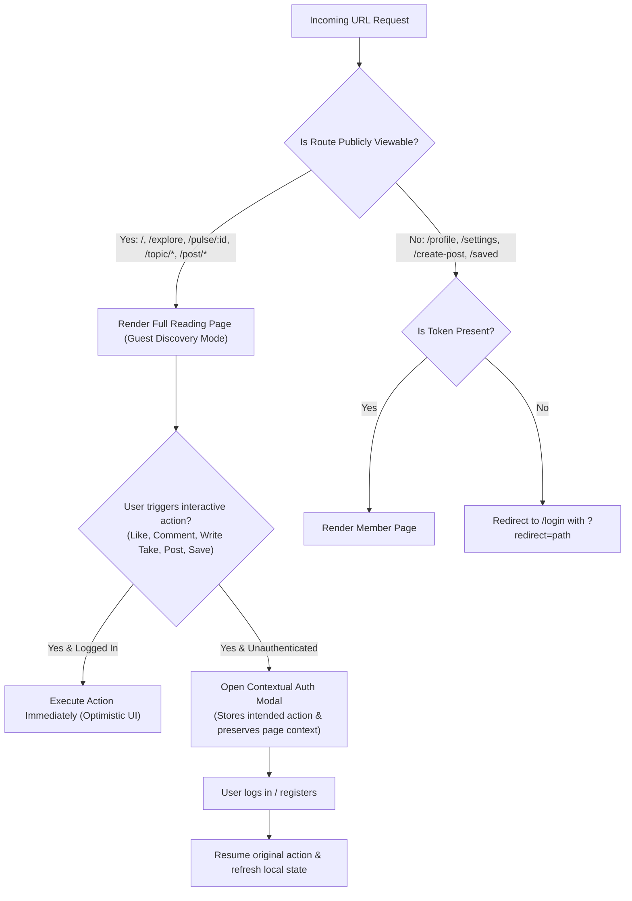

# Awaaj Man Ki — New Information Architecture Specification
## Document: NEW_INFORMATION_ARCHITECTURE.md

**Role:** Principal UX Architect  
**Objective:** Replace the confusing, inverted navigation model with an intuitive, content-first information architecture.

---

### 1. The Redesigned Information Architecture Tree

```mermaid
graph TD
    Root["Awaaj Man Ki Platform"]
    
    %% Public Reading Space (Guest Discovery)
    Root --> PublicSpace["Public Reading Space (No Login Required)"]
    PublicSpace --> HomeFeed["/ (Home: Unified Feed + Pulse Briefing)"]
    PublicSpace --> ExploreDiscovery["/explore (Trending Channels & Search)"]
    PublicSpace --> PulseArticle["/pulse/:id (Editorial Story & Community Takes)"]
    PublicSpace --> TopicChannel["/topic/:id (Channel Post Stream)"]
    PublicSpace --> PostView["/post/:id (Full Discussion Thread)"]
    PublicSpace --> PublicInfo["Public Static Pages (/about, /privacy, /guidelines, /faq)"]

    %% Contextual Auth Gates (Interaction Moments)
    HomeFeed -.->|"Upvote / Comment / Post"| AuthModal["Contextual Auth Modal (Login / Register)"]
    PulseArticle -.->|"Write Take / Upvote"| AuthModal
    TopicChannel -.->|"Join / Reply"| AuthModal

    %% Authenticated Member Space
    Root --> MemberSpace["Authenticated Member Experience"]
    MemberSpace --> Composer["/create-post (Thought Composer)"]
    MemberSpace --> MusicStation["/music (Ambient Station & Mood Playlists)"]
    MemberSpace --> Notifications["/notifications (Activity & Replies)"]
    MemberSpace --> Saved["/saved (Bookmarked Discussions)"]
    MemberSpace --> Profile["/profile (Anonymous Persona & Stats)"]
    MemberSpace --> Settings["/settings (Privacy, Language, Safety)"]
    
    %% Admin Space
    Root --> AdminSpace["Admin Editorial Hub (/admin/*)"]
```



---

### 2. Resolution of the "Home vs. Explore" Inversion

#### The Old Flaw:
- `/home` was a directory of 82 topic chips with no post stream.
- `/explore` was where the community feed was placed.

#### The New IA Definition:
1. **Home (`/` and `/home`): The Pulse of the Community**
   - The primary destination for fresh social activity.
   - Houses the **Unified Feed**: Segmented into *"For You"* (personalized based on followed topics) and *"Latest"* (chronological community stream).
   - Integrates the **Awaaj Pulse Daily Briefing** in the right column on desktop (or top carousel on mobile), providing instant news hooks without displacing social posts.
2. **Explore (`/explore`): The Catalog & Discovery Hub**
   - The place to discover new channels, search keywords, browse hashtags, and find trending creators.
   - Houses the **Topic Channel Directory** (organized into clean, collapsible category shelves: Feelings, Shayari, Cinema, Politics, Sports, Career).
   - Global search bar with instant debounced results across both posts and news stories.

---

### 3. Navigation Blueprint: Desktop vs. Mobile

#### A. Desktop 3-Column Navigation Grid (Max-Width: 1280px)

```
┌─────────────────────┬──────────────────────────────────────┬──────────────────────┐
│  LEFT NAV (240px)   │       FOCUSED FEED (680px)           │  RIGHT RAIL (320px)  │
├─────────────────────┼──────────────────────────────────────┼──────────────────────┤
│ [Logo] Awaaj Man Ki │ [Feed Tabs] For You  |  Latest       │ [Awaaj Pulse Live]   │
│                     │                                      │ Top 3 Stories Today  │
│ 🏠 Home             │ [Post Card 1]                        │ • Starlink Feud      │
│ 📰 Pulse News       │  Author Avatar + @handle • 2h        │ • Bigg Boss Debate   │
│ 🧭 Explore Channels │  "मनातलं काहीतरी..."                 │ • IND vs WI Cricket  │
│ 🎵 Ambient Music    │  [Voice Player 0:45]                 │                      │
│ 🔖 Saved Thoughts   │  💬 24 Comments   ❤️ 142 Likes       │ [Trending Channels]  │
│ 🔔 Notifications    │                                      │ #SHAYARI (1.4k posts)│
│ 👤 Profile          │ [Pulse Editorial Anchor]             │ #MERANETA (890 posts)│
│ ⚙️ Settings         │  Verified Publisher: The Hindu       │                      │
│                     │  Headline + 3 Key Bullet Points      │ [Ambient Music Mini] │
│ [+ Write Thought]   │  💬 48 Community Takes               │ Track: Sufi Night    │
│                     │                                      │ ▶ ⏸ ━━━━○━━━ 03:12  │
│ [Anonymous User]    │ [Post Card 2] ...                    │                      │
└─────────────────────┴──────────────────────────────────────┴──────────────────────┘
```

#### B. Mobile Ergonomics (Strict adherence: No new bottom tabs added)
The bottom navigation bar retains exactly 5 thumb-friendly tabs:
1. **Home** (`/home` — Unified feed + top Pulse briefing pill)
2. **Explore** (`/explore` — Channel catalog + search)
3. **Compose** (`+` center action button with prominent terracotta fill)
4. **Music** (`/music` — Ambient audio visualizer and playlist station)
5. **Profile** (`/profile` — User identity and settings)

*Key Mobile Enhancement:* The sprawling 82-item topic grid is replaced by a clean, swipeable horizontal channel rail at the top of the feed and collapsible category shelves on Explore. The vertical scroll depth is reduced from 4,200px to ~1,400px.

---

### 4. Gating & Redirection Logic


