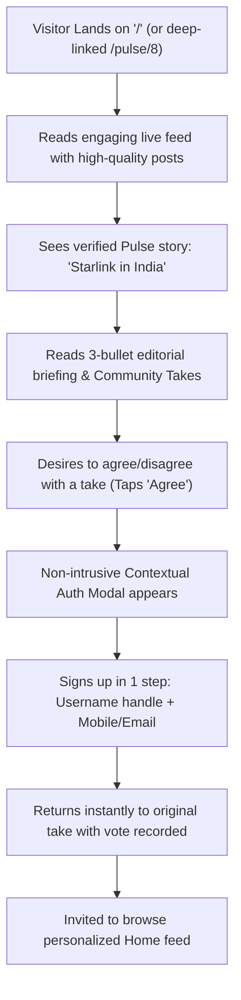
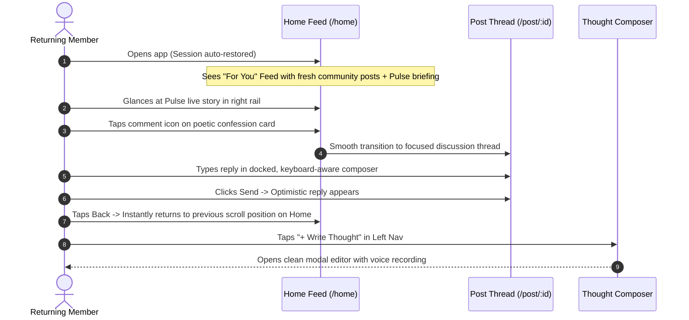
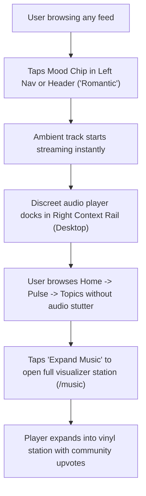
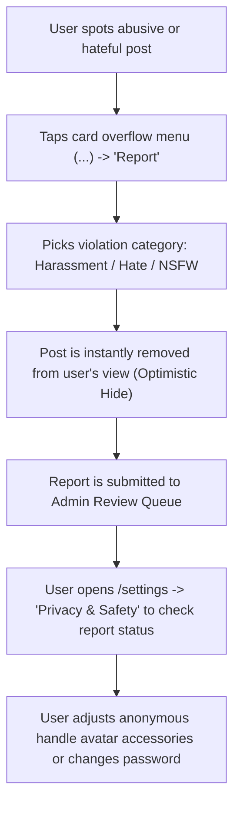

# Awaaj Man Ki — Proposed User Journeys Specification
## Document: PROPOSED_USER_JOURNEYS.md

**Role:** Principal UX Architect & Senior Product Designer  
**Objective:** Map seamless, frictionless user journeys for the redesigned platform, eliminating drop-off barriers, confusing forks, and dead ends.

---

### Journey A: New Visitor Experience (Frictionless Guest Discovery)

#### Analytical Breakdown:
- **Entry Point:** Direct URL (`/`), search link, or shared Pulse story.
- **Main Action:** Read community posts and editorial news without an account.
- **Secondary Action:** Tap reaction, upvote take, or bookmark thought.
- **Navigation Transitions:** Modals overlay existing content; page context is never lost.
- **Authentication Requirement:** Only prompted at the moment of active contribution.
- **Mobile Behavior:** Full touch-first card view with swipeable stories and zero login barriers.

---

### Journey B: Returning Community Member Experience

#### Analytical Breakdown:
- **Entry Point:** `/home`.
- **Main Action:** Browse personalized feed, engage with community, and compose thoughts.
- **Secondary Action:** Stream ambient background music, browse topic channels.
- **Scroll Preservation:** Navigating back from `/post/:id` strictly preserves previous scroll depth on `/home`.
- **Mobile Behavior:** Floating center action button opens full-sheet composer with draft auto-save.

---

### Journey C: Awaaj Pulse News Reader Experience

```mermaid
flowchart LR
    A["Home / Pulse Feed"] -->|"Filter by 'Technology'"| B["Pulse Story Card: 'Starlink in India'"]
    B -->|"Click Card"| C["/pulse/:id Editorial Hub"]
    C -->|"Read Headline & 3 Key Bullet Points"| D["Reads Community Perspectives Stream"]
    D -->|"Click 'Write Take'"| E["Opens 280-char Take Composer"]
    E -->|"Submits Anonymous Take"| F["Take appears instantly with sentiment pill"]
    F -->|"Scroll to bottom"| G["'More in Technology' Related Carousel"]
```

#### Analytical Breakdown:
- **Entry Point:** Home page briefing box, Explore feed, or dedicated Pulse tab.
- **Main Action:** Understand verified news context and participate in community debate.
- **Secondary Action:** Filter news by category (General, Tech, Sports, Cinema), view publisher source.
- **Conversational Unification:** Eliminates the split between takes and forum posts; all commentary lives directly on the story.
- **Failure State:** If network offline, cached news briefing renders with offline badge.

---

### Journey D: Ambient Music Listener Experience

#### Analytical Breakdown:
- **Entry Point:** Navbar mood pill, sidebar Music item, or inline voice player.
- **Main Action:** Listen to mood-based soundscapes and songs while reading.
- **Secondary Action:** Vote on tracks, add to favorites, queue next track.
- **Mobile Behavior:** Docks as an unobtrusive 36px top strip beneath the header, completely avoiding the bottom navigation bar.

---

### Journey E: Account, Identity & Safety Experience

#### Analytical Breakdown:
- **Entry Point:** Card context menu or Settings menu.
- **Main Action:** Report toxic content, update avatar persona, manage privacy toggles.
- **Secondary Action:** Export data, change language (Marathi, Hindi, English), request account deletion.
- **Safety Reassurance:** Always reminds the user: *"Your real IP and identity are shielded"*.
