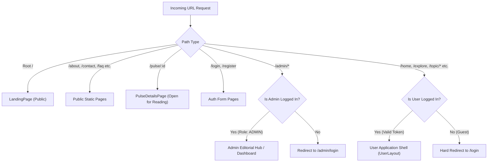

# Awaaj Man Ki — Phase 6A: Complete UI/UX & Design System Audit
## 02. Route and Page Inventory

**Source Code Reference:** [`AppRoutes.jsx`](file:///c:/Users/Niraj%20Ghube/OneDrive/Desktop/fron35/avaajmanki/src/routes/AppRoutes.jsx)  
**Router Type:** Custom History State Router (`window.history.pushState`, `popstate` listener) with `onNavigate` handler.

---

### 1. Architectural Routing Overview

The platform routes do not rely on third-party routing packages (e.g. `react-router-dom`). Instead, the routing is centrally governed by [`AppRoutes.jsx`](file:///c:/Users/Niraj%20Ghube/OneDrive/Desktop/fron35/avaajmanki/src/routes/AppRoutes.jsx) which evaluates `window.location.pathname`, normalizes slashes and query strings, and lazily mounts code-split pages via `React.lazy` and `React.Suspense`.

#### Global Route Hierarchy
```
/ (Root Landing)
├── Public Informational (/about, /privacy-policy, /community-guidelines, /contact, /faq, /delete-account, /child-safety)
├── Authentication Flows (/login, /register, /forgot-password, /onboarding, /setup-profile)
├── Public Editorial Stories (/pulse/:id)
├── Authenticated User App (/home, /explore, /music, /create-post, /topic/:id, /post/:id, /notifications, /saved, /my-posts, /my-reports, /profile, /settings, /help)
└── Admin Editorial & Moderation Hub (/admin/login, /admin/dashboard, /admin/pulse, /admin/reports, /admin/content-review, /admin/users, /admin/music, /admin/analytics)
```

---

### 2. Complete Detailed Route Table

| Route | Page Component | Purpose | Auth | Layout | Entry Points | Exit Paths | API Dependencies | Mobile Behavior | UX Issues |
|:---|:---|:---|:---|:---|:---|:---|:---|:---|:---|
| `/` | `LandingPage.jsx` | Introduce platform value proposition, showcase anonymous safety, promote topics, prompt join/login. | Public | Custom Landing Layout (Hero, Features, Footer) | Direct URL, Root navigation | `/login`, `/register`, `/about`, `/contact`, `/privacy-policy` | None (Static presentation) | Stacks hero elements vertically; floating badge hidden; high vertical scroll. | No live content preview; visitor cannot see what people are talking about before registering. |
| `/about` | `AboutPage.jsx` | Explains mission, anonymous ethics, psychological safety for regional voices. | Public | `PublicLayout.jsx` (Navbar + Footer) | Footer links, Landing CTA | `/`, `/login`, `/register`, `/contact` | None | Single column readability with comfortable padding. | Text-heavy; lacks interactive visual evidence or team transparency. |
| `/privacy-policy` | `PrivacyPolicyPage.jsx` | Legal disclosure of data retention, anonymous hash identity, GDPR/DPDP compliance. | Public | `PublicLayout.jsx` | Footer links | `/`, `/terms` | None | Narrow margin wrapping, readable line heights. | Formatted as dense wall-of-text without table-of-contents jump links. |
| `/community-guidelines` | `CommunityGuidelinesPage.jsx` | Rules on hate speech, harassment, impersonation, sexual content, and safe debates. | Public | `PublicLayout.jsx` | Footer links, Post creation link | `/`, `/help`, `/contact` | None | Clear numbered lists. | Missing visual dos-and-don'ts cards or concrete penalty explanations. |
| `/contact` | `ContactPage.jsx` | Support enquiry submission form with category selection. | Public | `PublicLayout.jsx` | Footer links, Help page | `/`, Form submission | `POST /api/enquiries` | Inputs stack full-width; submit button pinned. | No live chat or response SLA indicator; user left wondering if anyone reads it. |
| `/faq` | `FaqPage.jsx` | Answers common questions on identity safety, audio playback, report actions. | Public | `PublicLayout.jsx` | Footer links | `/`, `/help` | None | Collapsible accordion tap targets. | Limited search capability for FAQs; topics not categorized. |
| `/delete-account` | `DeleteAccountPage.jsx` | Policy and instructions for account deletion and data scrubbing. | Public | `PublicLayout.jsx` | Settings, Privacy links | `/settings`, `/login` | `POST /api/users/delete-request` | Centered card layout. | Abrupt flow; lacks two-factor verification warning. |
| `/child-safety` | `ChildSafetyPage.jsx` | Mandatory CSAM and minor protection compliance disclosures. | Public | `PublicLayout.jsx` | Footer | `/privacy-policy` | None | Text page. | Low visibility in footer hierarchy. |
| `/login` | `LoginPage.jsx` | Authenticate existing user via email/mobile and password. Supports admin login toggle. | Public | `AuthLayout.jsx` (Split screen with brand illustration) | Header "Login", Auth redirects | `/register`, `/forgot-password`, `/home`, `/admin/dashboard` | `POST /api/auth/login` | Split illustration hidden; single centered card; sticky virtual keyboard pushes submit button. | Password reveal icon is small; error banner disappears abruptly; mock fallback warning logs to console. |
| `/register` | `RegisterPage.jsx` | New user signup: Full Name, Email/Mobile, Password, and Terms acceptance. | Public | `AuthLayout.jsx` | Header "Sign Up", Login CTA | `/login`, `/setup-profile`, `/onboarding` | `POST /api/auth/register`, `POST /api/auth/verify-otp` | Single-column form with high input fields. | Multi-step registration creates high abandonment before user sees value. |
| `/forgot-password` | `ForgotPasswordPage.jsx` | Password reset link/OTP request via registered email or mobile. | Public | `AuthLayout.jsx` | Login form "Forgot Password?" | `/login` | `POST /api/auth/forgot-password` | Minimal form card. | Success message doesn't state email delivery time; no resend timer. |
| `/setup-profile` | `ProfileSetupWizardPage.jsx` | Choose anonymous avatar (2D presets or 3D builder), pick handle, and bio. | Login Required | Custom Wizard Layout | Post-registration redirect | `/home` | `POST /api/profile`, `GET /api/profile/suggestions` | 3D canvas disabled/simplified on low-end mobile. | High friction; forcing avatar creation before browsing frustrates impatient users. |
| `/onboarding` | `OnboardingPage.jsx` | Select initial topic interests (feelings, cinema, sports, politics) for feed curation. | Login Required | Fullscreen multi-card wizard | Post-profile setup | `/home` | `POST /api/profile/interests` | Multi-select chips with tap states. | User cannot skip onboarding; selecting interests doesn't visibly personalize Home yet. |
| `/pulse/:id` | `PulseDetailsPage.jsx` | Read editorial story, view summary, publisher source badge, community takes, comment stream, and reactions. | **Public for reading**; Login required for Takes/Comments | `UserLayout.jsx` if logged in; `PublicLayout.jsx` if guest | Happening Now carousel, direct link, Explore feed | `/home`, `/explore`, `/login` | `GET /api/pulse/items/:id`, `GET /api/pulse/:id/reactions`, `GET /api/pulse/:id/takes`, `POST /api/pulse/:id/takes` | Editorial image scaled 16:9; sticky discussion drawer at bottom. | Editorial text is short (summary only); lacks deep links to full external article reading inside modal; Take composer modal is crowded. |
| `/home` | `HomePage.jsx` | Central portal: Hero banner, search bar, Happening Now (Pulse), Category filter pills, and Topic Grid. | Login Required | `UserLayout.jsx` (TopNavbar + LeftSidebar + MoodWidget) | Default post-login, Navbar Home | `/topic/:id`, `/pulse/:id`, `/explore`, `/create-post` | `GET /api/topics/categories`, `GET /api/pulse/featured`, `GET /api/topics/custom` | Left sidebar hidden; bottom navigation active; topic grid becomes 1-column cards. | Highly overloaded screen. 80+ interactive chips. No recent posts stream — only topic categories. |
| `/explore` | `ExplorePage.jsx` | Global post discovery feed: Filter by trending, recent, media type, and topic hashtags. | Login Required | `UserLayout.jsx` | Navbar Explore, Bottom Nav Explore | `/post/:id`, `/topic/:id`, `/profile/:username` | `GET /api/posts/feed`, `GET /api/posts/search` | Infinite feed single column; reaction bar on each card. | Infinite scroll triggers layout shifts when audio player is active; no dedicated Pulse filter tab. |
| `/topic/:id` | `TopicDiscussionPage.jsx` | Dedicated discussion room for a specific topic (e.g. Shayari, Cricket, Politics). Shows topic banner and posts. | Login Required | `UserLayout.jsx` | Click topic card on `/home`, tag click | `/post/:id`, `/create-post`, `/home` | `GET /api/topics/:id`, `GET /api/posts/topic/:id` | Collapsible sidebar enters hover-strip mode; main column expands. | Left sidebar collapse behavior (`isTopicPage`) is disorienting; room header takes 35% of mobile screen. |
| `/post/:id` | `PostDetailsPage.jsx` | Deep dive into an individual post: Full content, voice note player, comments list, nested replies, reaction counter. | Login Required | `UserLayout.jsx` | Explore post click, notification click, topic stream | `/topic/:id`, `/profile/:username` | `GET /api/posts/:id`, `GET /api/comments/post/:id`, `POST /api/comments` | Comments list scrollable; fixed reply composer docked above bottom nav. | Floating reply input covers bottom comments on iOS Safari; nested reply depth > 2 breaks padding. |
| `/create-post` | `CreatePostPage.jsx` | Compose anonymous post: Text, Topic selector, Voice Note recording, Spoiler toggle, Mood selector. | Login Required | `UserLayout.jsx` | Navbar "+", Bottom Nav FAB, Topic "+ Post" | `/post/:id`, `/topic/:id`, `/home` | `POST /api/posts`, `POST /api/moderation/check`, `POST /api/posts/upload-audio` | Mobile FAB navigates here; full screen modal look. | Media upload button has vague file size limits; live moderation delay (AI) causes spinner hang without feedback. |
| `/music` | `MusicPage.jsx` | Mood-based music station: Discover tracks, select moods (Sad, Romantic, Focus, Devotional), browse queues. | Login Required | `UserLayout.jsx` (MoodMusicWidget suppressed to avoid duplication) | Sidebar Music, Navbar Mood widget | Song play, Track detail, Playlist add | `GET /api/music/tracks`, `GET /api/music/moods`, `POST /api/music/vote` | Horizontal category scrolling; audio spectrum visualizer scaled down. | Heavy DOM when visualizer is running; tracks require manual next-click if auto-play fails. |
| `/profile` / `/profile/:username` | `ProfilePage.jsx` | View avatar, anonymous bio, badges, user's published topics, recent takes, and activity history. | Login Required | `UserLayout.jsx` | TopNavbar Avatar, Post Author avatar click | `/edit-profile`, `/settings`, `/post/:id` | `GET /api/profile/:username`, `GET /api/posts/user/:username` | Avatar header centered; tab strip (Posts / Takes / Liked). | Visiting other anonymous profiles reveals handle consistency, which could compromise perceived anonymity if not carefully explained. |
| `/edit-profile` | `EditProfilePage.jsx` | Modify bio, change avatar accessories, update mood badge, select default language. | Login Required | `UserLayout.jsx` | Profile "Edit" button | `/profile` | `PUT /api/profile/me` | Form stacked vertically. | 3D avatar re-render is slow on mobile; no instant preview of updated handle. |
| `/notifications` | `NotificationsPage.jsx` | Real-time and persistent alerts: Post reactions, comment replies, community takes, system moderation warnings. | Login Required | `UserLayout.jsx` | TopNavbar Bell icon | `/post/:id`, `/pulse/:id` | `GET /api/notifications`, `PUT /api/notifications/read` | List with unread badge indicators. | No batch "Mark all as read" button; notification tap doesn't always highlight specific comment. |
| `/saved` | `SavedPostsPage.jsx` | Bookmarked posts and news discussions. | Login Required | `UserLayout.jsx` | Sidebar / Profile Saved tab | `/post/:id` | `GET /api/posts/saved` | Single-column card grid. | Empty state has no CTA to explore topics; no folder categorization. |
| `/my-posts` | `MyPostsPage.jsx` | Filtered archive of posts authored by current anonymous account. | Login Required | `UserLayout.jsx` | Sidebar "My Topics" | `/post/:id`, `/create-post` | `GET /api/posts/my` | Manage cards with delete/edit triggers. | Delete confirmation dialog uses standard browser confirm in some places instead of custom dialog. |
| `/my-reports` | `MyReportsPage.jsx` | User transparency dashboard showing status of reports submitted against content. | Login Required | `UserLayout.jsx` | Sidebar "My Reports" | `/help` | `GET /api/reports/my` | Table converts to stacked cards on mobile. | Rare feature in social apps; positive for safety, but confusingly placed in primary sidebar. |
| `/settings` (and `/settings/*`) | `SettingsPage.jsx` | Account settings: Privacy, Notifications, Language, Safety, Delete Account. | Login Required | `UserLayout.jsx` | Sidebar Gear icon, TopNavbar menu | Sub-settings pages, `/login` (Logout) | `GET /api/users/settings`, `PUT /api/users/settings` | List navigation with chevron arrows. | Sub-routes (`/settings/privacy`, `/settings/account`) have separate page files but repeat navigation shell. |
| `/help` | `HelpSupportPage.jsx` | Self-serve help center: FAQs, Contact Support, Safety Guidelines. | Login Required | `UserLayout.jsx` | Sidebar Help icon, Footer | `/contact`, `/faq` | None | Search bar + category tiles. | Duplicates informational footer links with slight variation. |
| `/admin/pulse` | `AdminPulsePage.jsx` | Complete Awaaj Pulse Editorial Hub: Candidate Review Queue, Published Stories, RSS Sources, Manual Creator. | Admin Required | `AdminLayout.jsx` (Admin Sidebar + Topbar) | Admin nav, direct URL | `/admin/pulse/candidates`, `/admin/pulse/sources`, `/pulse/:id` | `GET/POST /api/admin/pulse/*`, `GET /api/admin/pulse/sources`, `GET /api/admin/pulse/stats` | Not optimized for mobile; table scrolls horizontally. | Very dense; modal dialogues for candidate edit require large screens (1200px+). |
| `/admin/dashboard` | `AdminDashboardPage.jsx` | High-level system statistics: Total users, active posts, pending reports, blocked content overview. | Admin Required | `AdminLayout.jsx` | Admin login redirect | All `/admin/*` routes | `GET /api/admin/metrics`, `GET /api/admin/stats` | Metric grid collapses to 2 columns. | Charts lack date-range picker; logs tab links to generic blocked content page. |

---

### 3. Route Access & Gating Logic Matrix



---

### 4. Key Architectural Flaws in Current Route Management

1. **Lack of URL Query Parameter Sync:**  
   Search queries, tab selections (`activeCategoryTab`, `activeFilter`), and modal states are held in React component `useState` instead of URL query parameters. Refreshing `/home?category=FEELINGS` loses the filter state and resets to `"All"`.
2. **Prop-Drilling Navigation Handler:**  
   Because `onNavigate` must be passed manually from `AppRoutes` down through layouts, page wrappers, header components, and individual card sub-components, dozens of components carry boilerplate navigation props.
3. **Hard Auth Walls without Deep-Link Memory:**  
   If a user visits `/post/12` while unauthenticated, they are redirected to `/login`, but the original intended target path (`/post/12`) is not stored in state or query string (`/login?redirect=/post/12`). After login, they are dumped onto `/home`.
4. **Asymmetrical Pulse Experience:**  
   A guest can read `/pulse/8` directly, but clicking on a community take or author avatar immediately ejects them to `/login` without explaining why.
