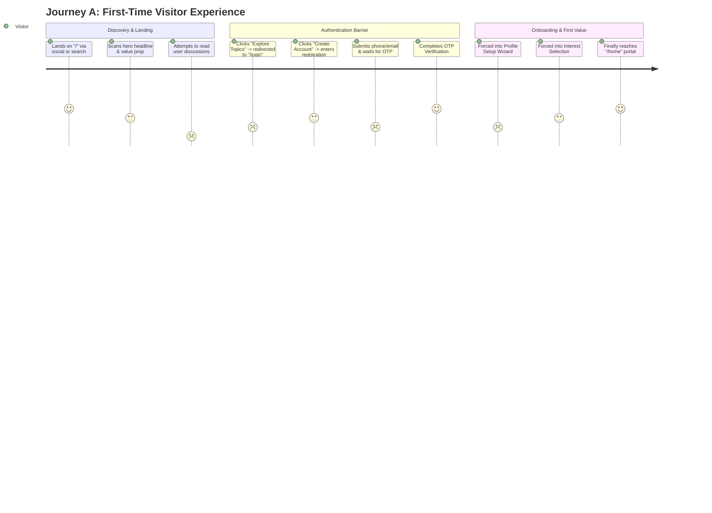
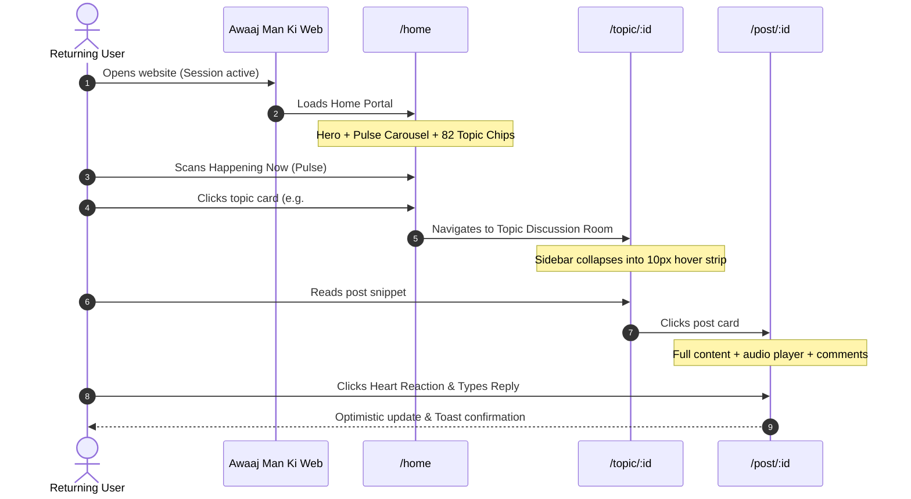
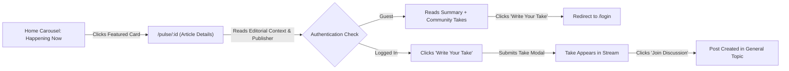
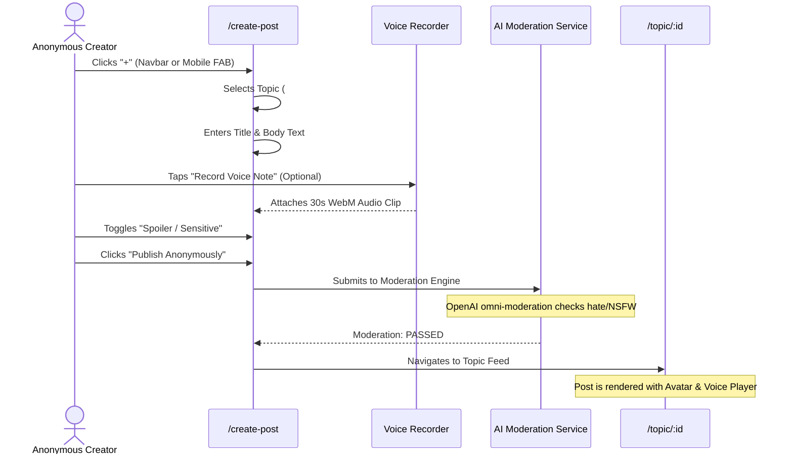
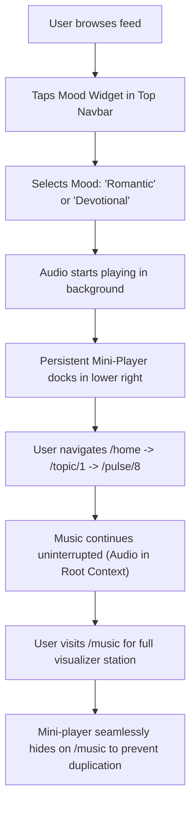
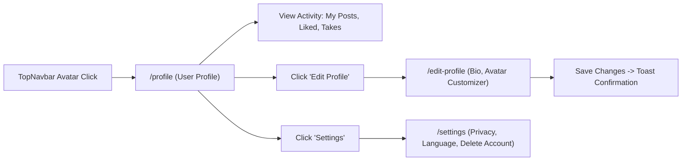

# Awaaj Man Ki — Phase 6A: Complete UI/UX & Design System Audit
## 03. Current User Journey Mapping

This document maps the actual step-by-step user journeys on the current platform, comparing designed flows with actual user realities and friction points.

---

### Journey A: First-Time Visitor Flow

#### Detailed Step-by-Step Breakdown:
1. **Landing on `/`:** The visitor sees an artistic landing page with a hero headline *"मनातलं बोला… ओळख सुरक्षित ठेवा"* and abstract illustrations.
2. **Intent to Explore Content:** The visitor looks for real social posts, recent confessions, or active debates. However, the landing page displays only static marketing cards and feature teasers.
3. **Hitting the Wall:** Clicking *"Join Community"* or *"Browse Topics"* triggers `onNavigate('/login')` or `onNavigate('/register')`. The visitor has not seen a single piece of live user content yet.
4. **Registration Friction:** The signup form requires:
   - Full Name (ironic for an anonymous platform)
   - Email or Mobile Number
   - Password (with uppercase, number, symbol rules)
   - OTP SMS/Email delivery check
5. **Mandatory Wizard Blockade:** After verification, the user cannot browse immediately. They are forced through:
   - Avatar Studio (`/setup-profile`): Must pick hair, skin, clothes or preset.
   - Onboarding (`/onboarding`): Must select 3+ topic interests.
6. **First Value Realized:** Only after 5 distinct screens and ~3 minutes does the user land on `/home`.
- **Friction Points:** High drop-off during registration; zero social proof before signup; contradictory request for real name on an anonymous platform.

---

### Journey B: Returning User Flow

#### Detailed Step-by-Step Breakdown:
1. **Opening `/home`:** The returning user lands on the primary dashboard. The ambient gradient top navbar and 3D hero banner welcome them.
2. **Scanning for Updates:** The user looks for fresh posts from topics they like. However, `/home` does **not** contain a chronological feed of posts. Instead, it displays the topic directory (Feelings, Shayari, Life, Politics) and the Awaaj Pulse news carousel.
3. **Navigating to Content:** The user must manually click into a specific topic card (e.g. `#SHAYARI` or `#MERANETA`) to see posts.
4. **Topic Room Interaction:** Upon entering `/topic/1`, the left sidebar collapses into an unexpected hover-trigger state (`isTopicPage` in `LeftSidebar.jsx`), causing the feed width to abruptly jump from 820px to 1160px.
5. **Reading & Reacting:** The user clicks a post, reviews comments, taps a heart/flame reaction, and adds a comment via `CommentComposer.jsx`. The optimistic UI updates smoothly.
- **Friction Points:** Home requires 2 clicks just to read the latest community post; sidebar layout shift on topic pages is jarring.

---

### Journey C: Awaaj Pulse Reader Flow

#### Detailed Step-by-Step Breakdown:
1. **Discovering News:** While on `/home`, the user notices the horizontal carousel under the Hero Banner titled *"Happening Now in India — LIVE PULSE"*.
2. **Card Content:** Cards display a high-resolution 16:9 thumbnail, publisher tag (e.g., `The Hindu (Technology)` or `BBC News`), category tag (`TECHNOLOGY`), and editorial summary.
3. **Opening Article (`/pulse/8`):** Clicking the card navigates directly to [`PulseDetailsPage.jsx`](file:///c:/Users/Niraj%20Ghube/OneDrive/Desktop/fron35/avaajmanki/src/pages/user/PulseDetailsPage.jsx).
4. **Reading Experience:** The user reads the verified headline, verified source attribution link, and editorial context.
5. **Guest vs. User Fork:**
   - **Guest:** Can read the summary and browse existing community takes. Attempting to write a take or react opens the login redirect.
   - **Logged In User:** Can click *"Write Your Take"* to open [`WriteYourTakeModal.jsx`](file:///c:/Users/Niraj%20Ghube/OneDrive/Desktop/fron35/avaajmanki/src/components/pulse/WriteYourTakeModal.jsx) (max 280 characters, anonymous handle attribution).
6. **Community Takes Stream:** Takes appear below the article in a clean speech-bubble stream with agree/disagree badges.
- **Friction Points:** The original full article is external; users have to leave the app to read beyond the summary. The "Join Discussion" action creates a separate post under `/topic/GENERAL`, fragmenting the discussion between the Pulse page comments and the topic room.

---

### Journey D: Content Creator Flow

#### Detailed Step-by-Step Breakdown:
1. **Entry Point:** Creator taps the top navbar "+" icon or mobile bottom navigation center FAB.
2. **Editor Interface (`/create-post`):** Clean card with topic selector dropdown, title input, markdown/text area, voice note recording interface, and mood tag picker.
3. **Voice Note Experience:** Creator can record directly from device microphone using MediaRecorder API. Duration is limited to 120s with audio playback preview.
4. **Anonymous Safety Check:** The creator's registered name is never displayed. Only their chosen anonymous avatar and `@handle` appear.
5. **Submission & Moderation:** The post goes through backend automated moderation. If flagged, it enters the admin review queue; if clean, it immediately publishes.
- **Friction Points:** No draft saving; if the user accidentally taps back or navigates away, form contents are wiped. No photo cropping tool for uploaded images.

---

### Journey E: Mood Music Listener Flow

#### Detailed Step-by-Step Breakdown:
1. **Discovery:** The user sees the pulsing music note icon and mood pill in the Top Navbar (`NavbarMoodWidget.jsx`) or in the Left Sidebar (`Music`).
2. **Mood Selection:** Clicking opens `MoodSelectionModal.jsx` displaying 6 ambient mood cards (Heartbreak, Romantic, Late Night Thoughts, Sufi/Devotional, Chill/Lofi, Energized).
3. **Background Playback:** Audio streams via HTML5 Audio element managed in `MoodMusicContext.jsx`. As the user clicks between routes, audio plays without stuttering or reloading.
4. **Mini-Player:** A floating waveform bar docks at the bottom-right corner with play/pause, volume slider, track title, and expand button.
5. **Full Music Station (`/music`):** Provides a 3D audio visualizer, playlist curation, community-uploaded tracks, and upvote buttons.
- **Friction Points:** On mobile, the mini-player overlaps with the bottom navigation bar unless specifically offset; audio fails to autoplay on iOS Safari without user gesture.

---

### Journey F: Profile and Account Management Flow

#### Detailed Step-by-Step Breakdown:
1. **Opening Profile:** User clicks their avatar thumbnail in the top right.
2. **Profile View:** Displays avatar graphic, handle (`@whispering_falcon`), join date, mood badge, bio, and 3 tabs:
   - *My Posts* (Authored confessions/discussions)
   - *Community Takes* (Short takes posted on Awaaj Pulse stories)
   - *Saved* (Bookmarked content)
3. **Customization (`/edit-profile`):** User can change their bio, switch avatar mood, or reopen the Avatar Creator Modal to re-customize features.
4. **Settings:** Allows language switching (Marathi, Hindi, English), notification toggles, and data deletion requests.
- **Friction Points:** Anonymous handle is permanent (cannot be changed without account reset); language switching reloads entire UI state.

---

### Journey G: Mobile User Experience Differences

| User Flow Step | Desktop Experience (1440px) | Mobile Experience (390px) | Delta & UX Impact |
|:---|:---|:---|:---|
| **Primary Navigation** | Fixed left sidebar (68px icon strip) + Sticky Top Navbar | Sticky Top Navbar + Fixed Bottom 5-Tab Bar (Home, Explore, +, Music, Profile) | Left sidebar completely hidden (`.desktop-only`); navigation is reachable with thumb, but takes up 60px bottom screen estate. |
| **Hero & Search** | Horizontal banner with decorative lighting orbs & wide search bar | Stacked banner; search bar takes 100% width; takes 320px of initial viewport | Displaces content below the fold; user must scroll 1.5 screens before seeing first topic. |
| **Happening Now Carousel** | 3.5 cards visible simultaneously; smooth desktop arrow buttons | 1.1 cards visible; horizontal touch swipe with snap scroll | Cards take up entire mobile screen width; user cannot see following cards without swiping. |
| **Topic Grid** | 3-4 column grid with roomy category cards | 1 column stacked cards | Massive vertical page length (~4,200px scroll depth on mobile). |
| **Music Player** | Floating pill widget in bottom-right corner | Full-width docked bar above bottom navigation | Covers bottom 120px of content if active; frequent mis-taps between player and bottom nav tabs. |
| **Discussion & Comments** | Side-by-side or wide modal sheet | Full-screen overlay; mobile virtual keyboard covers input field | Comment composer covers conversation when typing on iOS/Android. |
