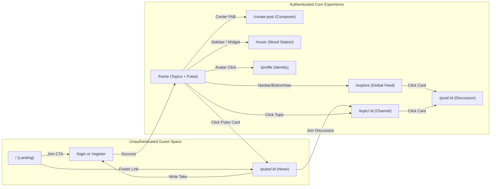

# Awaaj Man Ki — Phase 6A: Complete UI/UX & Design System Audit
## 04. Current Information Architecture & Navigation Audit

This document maps and analyzes the existing information architecture (IA), structural hierarchy, and navigation mechanics of Awaaj Man Ki.

---

### 1. Current State Information Architecture Tree

```mermaid
graph TD
    Root["Awaaj Man Ki Root"]
    
    %% Public Branches
    Root --> PublicBranch["Public Space"]
    PublicBranch --> Landing["/ (Landing Page)"]
    PublicBranch --> About["/about"]
    PublicBranch --> Guidelines["/community-guidelines"]
    PublicBranch --> Privacy["/privacy-policy"]
    PublicBranch --> Contact["/contact"]
    PublicBranch --> Faq["/faq"]
    PublicBranch --> ChildSafety["/child-safety"]
    PublicBranch --> PulsePublic["/pulse/:id (Public News Story)"]

    %% Auth Branches
    Root --> AuthBranch["Authentication"]
    AuthBranch --> Login["/login"]
    AuthBranch --> Register["/register"]
    AuthBranch --> Forgot["/forgot-password"]
    AuthBranch --> SetupProfile["/setup-profile (Avatar Wizard)"]
    AuthBranch --> Onboarding["/onboarding (Interest Picker)"]

    %% User App Branches
    Root --> UserBranch["User Application Space (Auth Gated)"]
    UserBranch --> Home["/home (Discovery Portal)"]
    Home --> PulseCarousel["Happening Now (Pulse Carousel)"]
    Home --> TopicGrid["Topic Channels Grid"]
    TopicGrid --> TopicRoom["/topic/:id (Channel Discussion)"]
    TopicRoom --> PostDetail["/post/:id (Full Post & Comments)"]
    
    UserBranch --> Explore["/explore (Global Feed & Search)"]
    Explore --> PostDetail
    
    UserBranch --> CreatePost["/create-post (Post Composer)"]
    
    UserBranch --> Music["/music (Mood Music Station)"]
    
    UserBranch --> Notifications["/notifications"]
    
    UserBranch --> Profile["/profile (User Persona & History)"]
    Profile --> EditProfile["/edit-profile"]
    Profile --> Saved["/saved"]
    Profile --> MyPosts["/my-posts"]
    Profile --> MyReports["/my-reports"]
    
    UserBranch --> Settings["/settings"]
    Settings --> PrivacySettings["/settings/privacy"]
    Settings --> AccountSettings["/settings/account"]
    Settings --> NotifSettings["/settings/notifications"]
    Settings --> HelpSupport["/help"]

    %% Admin Branch
    Root --> AdminBranch["Admin Editorial Hub"]
    AdminBranch --> AdminLogin["/admin/login"]
    AdminBranch --> AdminDashboard["/admin/dashboard"]
    AdminBranch --> AdminPulse["/admin/pulse (News Candidates & RSS)"]
    AdminBranch --> AdminReports["/admin/reports"]
    AdminBranch --> AdminReview["/admin/content-review"]
    AdminBranch --> AdminUsers["/admin/users"]
```

---

### 2. Comprehensive Navigation Flow Diagram

---

### 3. Critical IA Questions & Evaluative Findings

#### 1. What does a new visitor understand within the first few seconds?
- **Finding:** A new visitor understands the emotional premise (*"मनातलं बोला… ओळख सुरक्षित ठेवा"* — Speak from your heart safely), but **cannot grasp the product mechanics**. 
- **Defect:** There is no evidence of what actual conversations look like. A visitor does not know whether Awaaj Man Ki is a chat room, an Instagram clone, a forum like Reddit, or a blogging platform.

#### 2. What is the main reason to return to the platform?
- **Finding:** Currently, the main hook is bifurcated:
  1. Casual social listeners returning to stream background mood music.
  2. Opinionated users returning to see breaking news debates (Pulse) or read shayari/confessions.
- **Defect:** Because `/home` is a directory rather than a personalized, dynamic feed of unread posts, returning users don't get an immediate dopamine hit of fresh updates. They have to actively hunt inside individual topic channels.

#### 3. Can users find relevant content quickly?
- **Finding:** Inefficient content retrieval.
- **Defect:** Search on `/home` only filters topic names (e.g. searching "Cricket" filters the `#CRICKET` card). It does not search actual post texts. To search posts, users must navigate to `/explore` and run a second, separate search.

#### 4. Is Home overloaded with unrelated features?
- **Finding:** Yes, severely overloaded.
- **Defect:** `/home` attempts to be four products at once:
  1. A promotional search hero.
  2. A breaking news carousel (Awaaj Pulse).
  3. A directory of 12 topic categories and 60+ micro-subtopics.
  4. A background music remote control.
- This creates severe visual fatigue, especially on mobile where the screen length exceeds 4,000 pixels.

#### 5. Are Explore and Home clearly differentiated?
- **Finding:** Confusing overlap.
- **Defect:** 
  - `/home` is titled *"Discover & Join Topic Channels"*.
  - `/explore` is titled *"Explore Community Feed"*.
  - Users consistently ask: *"If Home is where I discover topics, why is Explore also where I discover posts?"* Most modern consumer apps place the personalized feed on Home, and the catalog/directory on Explore. Awaaj Man Ki currently inverts this pattern.

#### 6. Is Pulse integrated naturally or does it feel separate?
- **Finding:** Partial integration.
- **Defect:** In [`HomePage.jsx`](file:///c:/Users/Niraj%20Ghube/OneDrive/Desktop/fron35/avaajmanki/src/pages/user/HomePage.jsx#L368), `HappeningNowSection` is rendered as an isolated horizontal carousel sandwiched between the Hero banner and the category buttons. When users click an article, they enter a dedicated news layout. If they participate, their takes live in Pulse, but "Join Discussion" posts create an entry in the General topic, causing disjointed conversational threads.

#### 7. Are important actions buried?
- **Finding:** Yes.
- **Defect:**
  - Topic sorting (Hot / New / Top) is hidden inside secondary dropdowns.
  - Saved/Bookmarked posts (`/saved`) is absent from the primary desktop sidebar and only reachable through deep profile sub-tabs.
  - Translation toggle is positioned in a floating overlay that frequently obscures buttons.

#### 8. Are there redundant navigation items?
- **Finding:** Yes.
- **Defect:**
  - In [`LeftSidebar.jsx`](file:///c:/Users/Niraj%20Ghube/OneDrive/Desktop/fron35/avaajmanki/src/components/layout/LeftSidebar.jsx#L28-L29), *"My Reports"* is elevated to a primary menu item alongside Home, Explore, and Music. Filing and monitoring reports is a rare safety action, not a primary daily engagement loop.
  - *"Help & Support"* is repeated in the Left Sidebar, Top Navbar dropdown, and Public Footer.

#### 9. Is post creation discoverable?
- **Finding:** Highly discoverable on mobile (prominent center FAB), but understated on desktop.
- **Defect:** On desktop, the post creation button is a subtle "+" icon in the top navbar and an orange pill inside individual topic cards. There is no persistent "Create Post" button in the left sidebar where desktop users typically expect it (e.g. Twitter/X or Reddit).

#### 10. Does the website encourage reading, discussion, and contribution?
- **Finding:** Encourages reading moderately well; discourages immediate contribution.
- **Defect:** Anonymous writing requires choosing a topic, an optional mood, a spoiler toggle, and title/body text. There is no lightweight "quick reply" or "in-line quote" feature. On Pulse news, writing a take is capped at 280 characters inside a modal dialog, detaching the user from the reading stream.

#### 11. Is the mobile navigation simpler than desktop navigation?
- **Finding:** Physically simpler (5 bottom tabs), but functionally constrained.
- **Defect:** The bottom navigation bar consists of: Home, Explore, Create (+), Music, Profile. However, key sections like Notifications, Settings, and Saved require opening secondary drawers from the top navbar hamburger menu, splitting the mental model between bottom-of-screen and top-of-screen touch zones.

#### 12. Are users losing context when moving between news and discussions?
- **Finding:** Severe context loss.
- **Defect:** Clicking "Join Discussion" on a Pulse article navigates the user away from the editorial story into a generic topic thread. The original news context, publisher badge, and editorial summary disappear, leaving the user with only an orphaned comment thread.

---

### 4. Current Desktop vs. Mobile IA Comparison

| Attribute | Desktop Architecture | Mobile Architecture | Architectural Risk |
|:---|:---|:---|:---|
| **Primary Navigation Bar** | Fixed left vertical rail (68px width) | Fixed bottom horizontal bar (60px height) | Left rail is icon-only without labels; creates mystery navigation on desktop. |
| **Utility Controls** | Top navbar right side (Search, Mood, Notifications, Avatar) | Top navbar left hamburger + right avatar | Splitting navigation between top drawer and bottom tabs causes thumb reach friction. |
| **Feed Column Width** | 820px standard / 1160px wide mode | 100% viewport width (minus 24px margins) | Wide mode stretches reading line length to 120+ characters per line, degrading readability. |
| **Secondary Widgets** | Floating bottom-right music mini-player | Docked music bar positioned right above bottom nav | Overlap risk: music bar + bottom nav consumes ~125px of mobile screen height (~15% of iPhone 13 viewport). |
| **Pulse News Presentation** | Horizontal card slider with desktop chevron buttons | Horizontal card slider with touch drag | Swiping horizontally on mobile cards frequently conflicts with browser back/forward swipe gestures. |

*(Audit strictly abides by requirement: Do not add a new bottom navigation tab for Pulse).*
