# Awaaj Man Ki — Phase 6A: Complete UI/UX & Design System Audit
## 11. Awaaj Pulse Integration Audit

This document audits the implementation, user flow, component architecture, and conversational handoff of **Awaaj Pulse 1.0**, evaluating how editorial news connects to the anonymous discussion platform.

---

### 1. The Ideal vs. Actual Pulse Engagement Loop

The target user journey defined for Awaaj Pulse is:
$$\text{Discover} \longrightarrow \text{Read} \longrightarrow \text{Understand} \longrightarrow \text{Discuss} \longrightarrow \text{Contribute} \longrightarrow \text{Explore More}$$

```mermaid
flowchart TD
    subgraph TARGET_JOURNEY [Designed Ideal Loop]
        D1["Discover on Home (Happening Now)"] --> R1["Read Headline & Summary"]
        R1 --> U1["Understand Editorial Context & Verified Publisher"]
        U1 --> C1["Discuss / Read Community Perspectives"]
        C1 --> K1["Contribute: Post Anonymous Take (max 280 chars)"]
        K1 --> E1["Explore More Related Stories / Topics"]
    end

    subgraph ACTUAL_REALITY [Observed Current Reality]
        D2["Discovered on Home (Horizontal Card)"] --> R2["Click Card -> Navigates to /pulse/:id"]
        R2 --> U2["Reads Brief 2-3 sentence summary"]
        U2 --> BRK1{"Want full article?"}
        BRK1 -->|"Yes"| EXT["Exits app to external publisher website (Off-Platform Drop-off)"]
        BRK1 -->|"No"| C2["Reads Takes"]
        C2 --> BRK2{"Guest or User?"}
        BRK2 -->|"Guest"| WALL["Taps 'Write Take' -> Hard redirect to /login"]
        BRK2 -->|"Logged In"| K2["Opens modal -> Writes Take"]
        K2 --> BRK3{"Taps 'Join Discussion'"}
        BRK3 --> POST["Creates detached post in /topic/GENERAL (Fragmented Context)"]
    end
```

---

### 2. Deep-Dive Component & Flow Evaluation

#### A. "Happening Now in India" Placement on `/home`
- **Location:** In [`HomePage.jsx#L368`](file:///c:/Users/Niraj%20Ghube/OneDrive/Desktop/fron35/avaajmanki/src/pages/user/HomePage.jsx#L368), placed between the top Hero Banner and Category Filter Tabs.
- **Section Header:** Features flame icon in a warm plum box, bold title (*"Happening Now in India"*), and glowing gradient badge (*"LIVE PULSE"*).
- **Carousel Geometry:** Displays up to 10 featured items fetched via TanStack Query (`GET /api/pulse/featured?limit=10`).
- **Graceful Degrade:** In `HappeningNowSection.jsx#L35`, if the query returns 0 items or errors, the component renders `null`, ensuring the homepage remains clean.
- **Verdict:** Highly effective placement. It gives the homepage instant topical relevance and editorial authority.

#### B. Featured News Card (`PulseFeaturedCard.jsx`)
- **Card Geometry:** `340px × 380px` container with `22px` border radius (`--radius-lg`), `1px solid var(--border-light)`, and `--shadow-soft`.
- **Thumbnail:** `340px × 180px` image with bottom gradient vignette (`rgba(45,29,21,0.85)`).
- **Publisher Attribution:** Floating white pill badge with publisher icon and name (e.g. `The Hindu (Technology)`, `BBC News - World`).
- **Category Pill:** Upper right badge (e.g. `TECHNOLOGY`, `ENTERTAINMENT`, `SPORTS`).
- **Typography:** 2-line headline clamp (16px bold, `#2D1D15`) + 2-line summary clamp (13px, `#8C8385`).
- **Footer:** Relative timestamp (e.g., `4 hours ago`) and comment/take counter pill.
- **Verdict:** Very high aesthetic quality. Looks like a modern news publication card.

#### C. Article Details Page (`PulseDetailsPage.jsx`)
- **Header & Breadcrumbs:** Clear "← Back to Home" link.
- **Publisher Transparency:** Prominent source badge with external link icon (*"Read original coverage on The Hindu ↗"*).
- **Public Gating:** The page is explicitly configured in `AppRoutes.jsx#L191` to allow **unauthenticated public reading**. Guests can read the story, review verified editorial context, and read community reactions without logging in.
- **Weakness:** The article content is only 1–2 paragraphs (derived from RSS item description). Readers expecting an in-depth article have to leave the site.

#### D. "Write Your Take" Flow (`WriteYourTakeModal.jsx`)
- **Mechanism:** Triggered by prominent plum button on `/pulse/:id`.
- **Character Constraint:** 280-character live counter.
- **Safety Posture:** Explicitly reminds the user: *"Your take will be published anonymously under @{handle}"*.
- **Post-Submission:** Take appears instantly in the Community Takes stream below the article via TanStack Query invalidation.
- **Verdict:** The highlight of the Pulse experience. It is fast, intuitive, and perfectly calibrated for mobile social commentary.

#### E. "Join Discussion" vs. Community Takes Conflict
- **The Core Problem:** The page presents **two** competing conversational actions:
  1. *"Write Your Take"* (Creates a short take on `/pulse/:id`)
  2. *"Join Discussion"* (Navigates the user to create a social post in `/topic/GENERAL`)
- **Why It Fails:** Users don't understand the difference. Those who click "Join Discussion" are taken to a different page, where their post loses the visual headline, publisher badge, and news image. The discussion is split into two disconnected silos.

---

### 3. Verification of Pulse Journey Failure Points

| Journey Step | Intended Experience | Observed Failure Point | Severity |
|:---|:---|:---|:---:|
| **1. Discover** | Glance at headline on Home | Carousel cards are 340px wide; on 375px mobile, only 1 card is visible, hiding other breaking news. | **Medium** |
| **2. Read** | Read full news story | Only summary is available; clicking original source redirects to external news website off-platform. | **High** |
| **3. Understand** | Grasp key facts & context | Editorial summary is an unformatted RSS description snippet without structured bullet points or key takeaways. | **Medium** |
| **4. Discuss** | Read what community thinks | Community takes stream is buried below the fold on mobile. | **Medium** |
| **5. Contribute** | Submit quick perspective | "Write Your Take" works well, but "Join Discussion" fragments user commentary into an orphaned topic post. | **Critical** |
| **6. Explore More**| Jump to related stories | No "Related Stories" or "More in Technology" carousel at bottom of article details page. | **High** |

---

### 4. Recommendations for Pulse Architecture in Phase 6B

1. **Unify the Conversational Model:** Deprecate the separate "Join Discussion" redirect. Unify all commentary directly on `/pulse/:id` as Community Takes with threaded replies.
2. **Add Structured Key Takeaways:** Format editorial summaries with 3 quick bullet points (*"What happened"*, *"Why it matters"*, *"The big question"*) to encourage thoughtful takes.
3. **In-App Reader Modal:** For users wanting full publisher coverage, provide an embedded reader or preview drawer rather than forcing an external tab launch.
4. **Related Stories Carousel:** Place a "More Stories in India" row at the bottom of `/pulse/:id` to keep readers in the loop.
