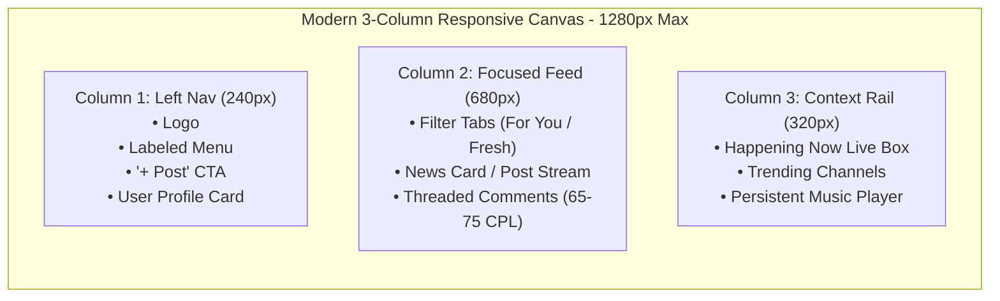

# Awaaj Man Ki — Phase 6A: Complete UI/UX & Design System Audit
## 14. Redesign Opportunities & Strategic Roadmap

This document outlines high-impact design opportunities and strategic recommendations for Phase 6B, setting the stage for a premium consumer redesign.

---

### 1. Vision: Transitioning from Functional Platform to Premium Consumer Experience

Awaaj Man Ki has established unique differentiation: **authentic vernacular voice, anonymous psychological safety, and mood-driven audio**. To evolve from an experimental community into a tier-1 consumer platform (comparable to Threads, Substack, or Reddit), the product must bridge five architectural gaps:

```
┌────────────────────────────────────────────────────────┐
│            THE 5 PILLARS OF THE PHASE 6B REDESIGN      │
├────────────────────────────────────────────────────────┤
│ 1. Standard 3-Column Desktop Architecture              │
│    (240px Labeled Sidebar + 680px Feed + 320px Widgets)│
│                                                        │
│ 2. Public "Guest Discovery" Mode                       │
│    (Read feeds freely; authenticate only on action)    │
│                                                        │
│ 3. Unified Conversational Anchor for Awaaj Pulse       │
│    (All debates live directly on the news story)       │
│                                                        │
│ 4. Accessible & Calm Design Token System               │
│    (Minimum 44px touch targets; strict color tokens)   │
│                                                        │
│ 5. Cohesive Mobile Ergonomics                          │
│    (Collapsible drawers, smart keyboard-aware sheets)  │
└────────────────────────────────────────────────────────┘
```

---

### 2. Opportunity 1: The Modern 3-Column Desktop Layout

#### Current Flaw:
Desktop alternates between an icon-only 68px sidebar, an 820px feed with empty gutters on 1920px screens, and an overstretched 1,160px wide mode that hurts reading comprehension.

#### Recommended Redesign:
Adopt a responsive 3-column layout standard:
- **Left Column (240px):** Fixed navigation rail with clear text labels (Home, Pulse News, Explore, Music, Saved, Profile, Settings) and a prominent "+ New Post" primary CTA button.
- **Center Column (680px):** Focused reading stream capped at a maximum of 75 characters per line, providing optimal typographic rhythm for both Latin and Devnagari text.
- **Right Column (320px):** Dynamic context rail:
  - *When on Home/Explore:* Shows "Happening Now in India" mini-feed and trending topics.
  - *When in a Topic Room:* Shows topic stats, moderators, and active voice notes.
  - *When playing music:* Hosts the persistent mini-player and queue without obscuring content.



---

### 3. Opportunity 2: Public "Guest Discovery" Experience

#### Current Flaw:
New visitors hit an immediate login wall when attempting to view `/home`, `/explore`, or `/topic/*`, driving high bounce rates before visitors ever see community value.

#### Recommended Redesign:
- **Read-First Philosophy:** Open the social feeds, topic rooms, and Pulse discussions for public reading.
- **Contextual Friction (Interaction Gate):** Only prompt authentication when the user attempts to:
  - Upvote or react to a post.
  - Post a Community Take or comment.
  - Create a new anonymous post or channel.
  - Bookmark content.
- **Benefits:** Massive improvement in organic SEO indexing, viral social link sharing, and lower registration drop-off.

---

### 4. Opportunity 3: Unifying the Awaaj Pulse Conversation

#### Current Flaw:
Users are forced to choose between writing a 280-character take or "Joining the Discussion" (which creates a separate post under `/topic/GENERAL`), splitting comments into two disconnected places.

#### Recommended Redesign:
- **Single Source of Truth:** Every Pulse story (`/pulse/:id`) becomes its own self-contained discussion hub.
- **Editorial Briefing Format:** Structure summaries into:
  1. *What Happened* (1-sentence headline fact)
  2. *Context & Nuance* (Key bullet points)
  3. *The Big Question* (Editorial discussion prompt)
- **Direct Reaction Stream:** Users post takes directly beneath the briefing, with inline threaded replies and agree/disagree badges.

---

### 5. Opportunity 4: Mobile Ergonomics & Tap Target Compliance

#### Current Flaw:
67 of 82 interactive elements on mobile `/home` fail the minimum 44×44px touch target guideline, leading to frequent mis-taps.

#### Recommended Redesign:
- **Subtopic Consolidation:** Instead of displaying 10 loose 26px chips inside every card, show the top 3 with a `"+4 more"` expandable sheet.
- **Full-Width Category Accordions:** Let users expand only the category they care about, reducing mobile page height from 4,200px down to ~1,400px.
- **Docked Music Drawer:** Integrate the background music player into the top navbar or a sleek bottom swipe-sheet, keeping it clear of the 5-tab bottom navigation bar.

---

### 6. Phase 6B Prioritized Redesign Implementation Roadmap

```
┌────────────────────────────────────────────────────────────────────────────────┐
│ PHASE 6B.1: Core Design Tokens & Layout Foundation                             │
│ • Establish strict semantic CSS tokens (Plum scale, border tokens, radii).    │
│ • Implement 3-column desktop layout (240px Labeled Nav, 680px Feed, 320px Rail).│
│ • Enforce 44px minimum touch targets across all mobile interactive elements.   │
├────────────────────────────────────────────────────────────────────────────────┤
│ PHASE 6B.2: Guest Discovery & Auth Modernization                               │
│ • Open read-only post feeds and topic rooms to guests.                         │
│ • Implement smart contextual login modals with redirect memory.                │
│ • Streamline registration to remove redundant real name requirements.          │
├────────────────────────────────────────────────────────────────────────────────┤
│ PHASE 6B.3: Awaaj Pulse Experience Elevation                                   │
│ • Unify conversational model directly on /pulse/:id.                           │
│ • Add structured editorial briefs (What Happened / Context / The Big Question).│
│ • Add "More Stories in India" related carousel at bottom of articles.          │
├────────────────────────────────────────────────────────────────────────────────┤
│ PHASE 6B.4: Audio, Motion & Accessibility Polish                               │
│ • Add full @media (prefers-reduced-motion) support.                            │
│ • Throttle navbar scroll handlers to prevent frame drops.                      │
│ • Redesign mobile music mini-player to eliminate bottom nav overlap.           │
└────────────────────────────────────────────────────────────────────────────────┘
```
